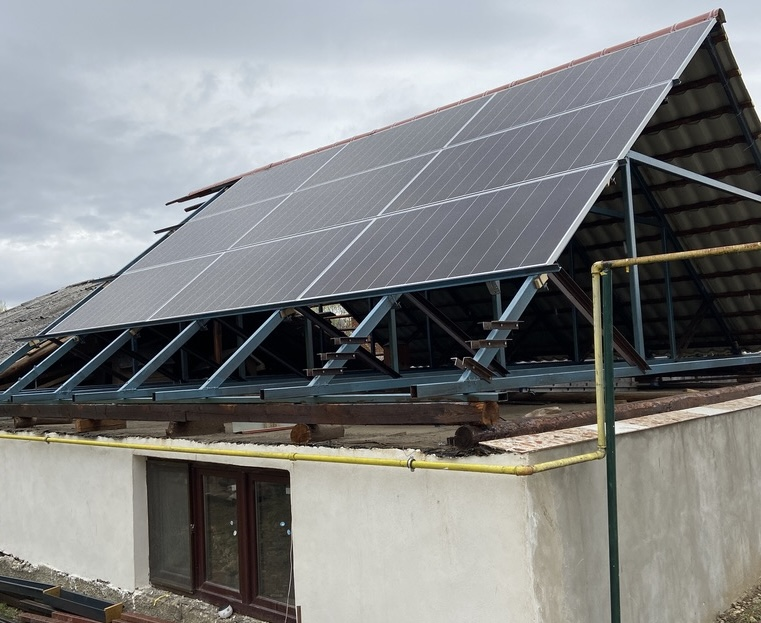

# F-Roof

A single-layer, multi-function roof.

The purpose of the __F-Roof__ is to:

- Provide electrical energy to the house.
- Provide food (vegetables) for the house's inhabitants.
- Use structure as function (solar panels and plants' pots are the roof).
- Protect the house from rain and snow.

## Why F-Roof?

Because:

- Most of the roofs have a single function: to protect the house from rain and snow. We want more from a roof!
- Ground-level soil should be used for growing trees, not vegetables. Vegetables have small roots that require less soil.
- Existing roof-gardens have too many unnecessary layers, thus being expensive. One layer should be enough.
- Soil on the roof provides thermal insulation, so the attic becomes less hot during summer.
- The air behind solar panels could be circulated (with a fan) so the panels' temperature will be reduced and their efficiency will be increased.
- Wood should not be utilized for construction purposes. Trees are more important than for building houses!
- Utilize a minimal amount of materials (solar panels and plant pots have a dual purpose: they provide energy/food and make the roof's structure).

## Maker

[Mihai Oltean](https://mihaioltean.github.io)

## Project location

Street: **Gheorghe Lazăr 9**, town: **Cugir**, country: **Romania**. [Google Maps location](https://maps.app.goo.gl/KsL6PsEaSgzJYHLw7)

## CAD files

[F-Roof CAD repository](https://github.com/f-roof/cad)

## Materials, tools and software

Brief info is given below. More details are in the links.

### Software

- [OpenSCAD](https://openscad.org) - for design.
- [Real Cut 1D](https://optimalprograms.com/realcut1d.htm) - for minimizing the waste when cutting linear materials (bars). (Only if you have many bars to choose from.)

### Materials

Almost the entire roof is made from metal.
All units are in mm.

- 80x40x3 rectangular tubes.
- 60x40x3 rectangular tubes.
- 50x30x2 rectangular tubes.
- T40 profiles.
- L40 profiles.
- Solar panels. I utilized *Hyundai 485W*.
- Rectangular gutters (filled with soil for plants). I made them by myself from metal sheets.
- Roof tiles and some wooden boards (if you do not have enough solar panels or gutters).
- wooden boards of 4500x140x40 (used as support for gutters).
- Screws (M8x100, M8x60, etc) (stainless steel), auto-drilling screws.
- M8 auto-lock nuts stainless steel.
- Paint, wood varnish.
- Mastic (around the solar panels).

### Tools

- Band saw (able to cut 80x40mm rectangular tube at 52 degrees angle). I have a [PILOUS ARG 130 mobil](https://www.pilous.cz/en/metal/bandsaws/manual/arg-130-mobil).
- Drill machine. I have a [Milwaukee M18 FDD3](https://www.milwaukeetool.com/).
- Welding machine. I have a [Lorch Handy 160](https://lorch.eu).
- Screwdriver (preferably electric).
- Drill bits.
- Many others...

## Build instructions

- Cut the bars to required size and angle,
- Build (weld) the trusses,
- Lift trusses onto the house,
- Connect trusses with T40 profiles,
- Place solar panels on the South side,
- Prepare gutters with plants (at the ground level),
- Prepare (cut) the steps for supporting the gutters,
- Build some balustrade for hand support,
- Lift plant gutters on the roof (North side),
- Apply bituminous tape, behind gutters, to insulate against water leakage,
- Water the plants (every summer day).

More details are in [instructions.md](instructions.md)

## Cost

- The entire roof is 15m width, and 7m long (the base).

- Prices do not include manufacturing (which I did it by myself) and tools (which I already have).

- Prices are specific to my region (Cugir, Romania). I have not searched for better prices from distant stores. Prices do not include shipping (because I purchased the materials from nearby stores and the shipping was free).

- Prices include VAT.

Will be updated ...

### Cost of the roof

This is the cost of entire roof without garden and panels. Tiles will cover the entire surface. The tiles cost must be subtracted if you build the garden and solar.

|Material     |Quantity |Unit |Price per unit| Total price (EURO)|
| ----------- | ------- | --- | ------------ | ----------------- |
|80x40x3 tubes| 63      |m    |              |390                |
|60x40x3 tubes| 98      |m    |              |490                |
|T40|42|m||245|
|Gutters for rain|32|m|10|320|
|Metal tiles|141|$m^2$||284|
|Wood laces (50x30mm), 4m long|91|m||50|
|Screews, nuts, washers|Many|pcs||300|

### Cost of the roof-garden

This is the cost of roof garden.

width = 2.4m; length = 4.5 m.
  
|Material     |Quantity |Unit |Price per unit| Total price (EURO)|
| ----------- | ------- | --- | ------- | --- |
|Metal sheet 0.5mm thick, 2x1.25m|11|pcs| 25  | 275 |
|50x30x2 tubes| 20      |m    |         10    | 100             |
|Wood boards (140x40mm), 5m long|3|pcs|25|75|
|Wood boards (120x80x25mm)|81|pcs|0.1|10|
|Mastic|9|pcs|8|72|
|Wood screews|Many|pcs|0.1|20|

### Cost of the solar panels

width = 6.5m ; length = 4.5m

|Material     |Quantity |Unit |Price per unit| Total price (EURO)|
| ----------- | ------- | --- | -------------| ----------------- |
|Solar panels |9        | pcs | 100          | 900 |

## Videos

_2026_

Roof garden on [YouTube](https://www.youtube.com/watch?v=ebjUevM9GPM).

_2025_

A video with the exterior and interior of the roof can be found on [YouTube](https://www.youtube.com/watch?v=yZRalp4EQG4).

Another video taken by "Ziarul Unirea" newspaper is here on [YouTube](https://www.youtube.com/watch?v=QPRrpcEwZV0).

## Pictures

Pictures are [here](../pictures/).

## Cite as

Mihai Oltean, *F-Roof: A multi-function single-layer roof*, 2023.

## Related projects

[Wall Garden](https://github.com/wall-garden).

## License

MIT. You may do whatever you want with this information as long as you mention the author.

## Special thanks to

Nicolae Oltean, Emil Roșu, Dorin Popa, Daniel Cotoară, Cristian Simina, Traian Mărginean, Simona Dumitriu, Eduard Șuică, Adi Gorea ... and many others ...

## Warning

- I offer *NO warranty* for the information provided in this project!

- I am *NOT an expert* in ANY of the subjects used in the design and construction of this project! 

- Use it on *your OWN risk*!

- This is a work in progress. Everything might change depending on the experiment results.

## Press and Media appearances

Will be updated ...
